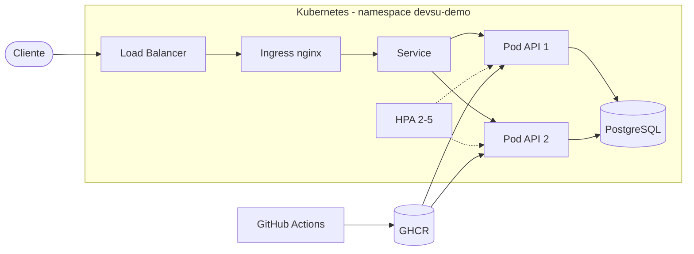
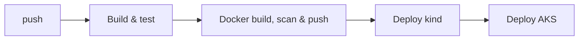

# Demo DevOps Python

[](https://github.com/XavierValencia/devsu-demo-devops-python/actions/workflows/ci-cd.yml)

API REST en Django dockerizada, con pipeline CI/CD en GitHub Actions, desplegada en Kubernetes
e infraestructura en Azure (AKS) creada con Terraform.

| Ítem | Valor |
|---|---|
| Pipeline | https://github.com/XavierValencia/devsu-demo-devops-python/actions |
| Imagen | `ghcr.io/xaviervalencia/devsu-demo-devops-python:<commit-sha>` |
| Endpoint público | `http://<IP-publica>/api/users/` |

## Arquitectura



## Estructura

```
.
├── api/, demo/            Aplicación Django
├── Dockerfile
├── .github/workflows/     Pipeline CI/CD
├── k8s/                   Manifiestos Kubernetes (Kustomize)
├── scripts/               deploy.sh y smoke-test.sh
└── infra/terraform/       AKS en Azure
```

## Ejecución local

```bash
pip install -r requirements-dev.txt
cp .env.example .env
python manage.py migrate
python manage.py test
python manage.py runserver
```

Docker:

```bash
docker build -t devsu-demo-python .
docker run -p 8000:8000 -e DJANGO_SECRET_KEY=local devsu-demo-python
curl http://localhost:8000/health/live
```

## Imagen Docker

- Base `python:3.11-slim`.
- Usuario no root (UID 10001).
- Puerto `8000`, servidor `gunicorn`.
- `HEALTHCHECK` sobre `/health/live`.
- Configuración por variables de entorno: `DJANGO_SECRET_KEY`, `DEBUG`, `ALLOWED_HOSTS`, `POSTGRES_*`.

Cambios en la aplicación:

- Configuración por variables de entorno y PostgreSQL cuando existe `POSTGRES_HOST` (SQLite en local y tests).
- Endpoints `/health/live` y `/health/ready`.
- Django 5.2 LTS (la 4.2 está fuera de soporte desde abril 2026).
- Nuevos tests: DNI duplicado, payload inválido, usuario inexistente y health checks.

## Pipeline CI/CD



| Job | Pasos |
|---|---|
| Build & test | Compilación, análisis estático (ruff, bandit), pruebas unitarias, cobertura (mínimo 80 %) |
| Docker | Build, escaneo de vulnerabilidades (Grype), push a GHCR |
| Deploy kind | Cluster Kubernetes efímero, despliegue y smoke test |
| Deploy AKS | Despliegue en Azure (se activa con la variable `DEPLOY_AKS=true`) |

Secrets de GitHub para AKS: `KUBE_CONFIG`, `DJANGO_SECRET_KEY`, `POSTGRES_PASSWORD`.

### Resultado de ejecución

Ejecución pública: https://github.com/XavierValencia/devsu-demo-devops-python/actions/runs/43119635259

| Job | Resultado |
|---|---|
| Build & test | ✅ success |
| Docker build & push | ✅ success |
| Deploy to Kubernetes (kind) | ✅ success |
| Deploy to AKS | ⏭️ skipped (pendiente de habilitar `DEPLOY_AKS`) |

Resultados locales de las pruebas:

| Paso | Resultado |
|---|---|
| Tests unitarios | 9 tests OK |
| Cobertura | 98 % (mínimo 80 %) |
| Análisis estático | ruff y bandit sin hallazgos |

Capturas en [docs/evidencias](docs/evidencias).

## Kubernetes

| Recurso | Uso |
|---|---|
| Namespace | `devsu-demo` |
| ConfigMap | Configuración de la app y de PostgreSQL |
| Secret | `DJANGO_SECRET_KEY` y `POSTGRES_PASSWORD`, creado por `deploy.sh` (no se versiona) |
| Deployment | 2 réplicas, initContainer de migraciones, liveness/readiness probes, recursos |
| Service | ClusterIP |
| Ingress | nginx |
| HPA | 2 a 5 réplicas al 70 % de CPU |
| StatefulSet | PostgreSQL con volumen persistente |

Despliegue local con minikube:

```bash
minikube start
minikube addons enable ingress
minikube addons enable metrics-server
eval $(minikube docker-env)
docker build -t devsu-demo-python:local .
export DJANGO_SECRET_KEY=$(openssl rand -hex 32) POSTGRES_PASSWORD=$(openssl rand -hex 16)
bash scripts/deploy.sh devsu-demo-python:local
bash scripts/smoke-test.sh http://$(minikube ip)
```

## Terraform (Azure)

```bash
cd infra/terraform
cp terraform.tfvars.example terraform.tfvars
az login
terraform init
terraform apply
terraform output -raw kube_config > devsu.kubeconfig
```

Para eliminar: `terraform destroy`.

## Consideraciones para producción

- Dominio propio y TLS con cert-manager.
- Base de datos gestionada (Azure Database for PostgreSQL).
- Secretos en Azure Key Vault.
- Monitoreo y alertas.
- Estado de Terraform remoto.

## API

### Create User

`POST /api/users/`

```json
{ "dni": "dni", "name": "name" }
```

Respuesta `201`:

```json
{ "id": 1, "dni": "dni", "name": "name" }
```

Respuesta `400`:

```json
{ "detail": "User already exists" }
```

### Get Users

`GET /api/users/` → `200`

```json
[ { "id": 1, "dni": "dni", "name": "name" } ]
```

### Get User

`GET /api/users/<id>/` → `200`

```json
{ "id": 1, "dni": "dni", "name": "name" }
```

Respuesta `404`:

```json
{ "detail": "No User matches the given query." }
```

## License

Copyright © 2023 Devsu. All rights reserved.
